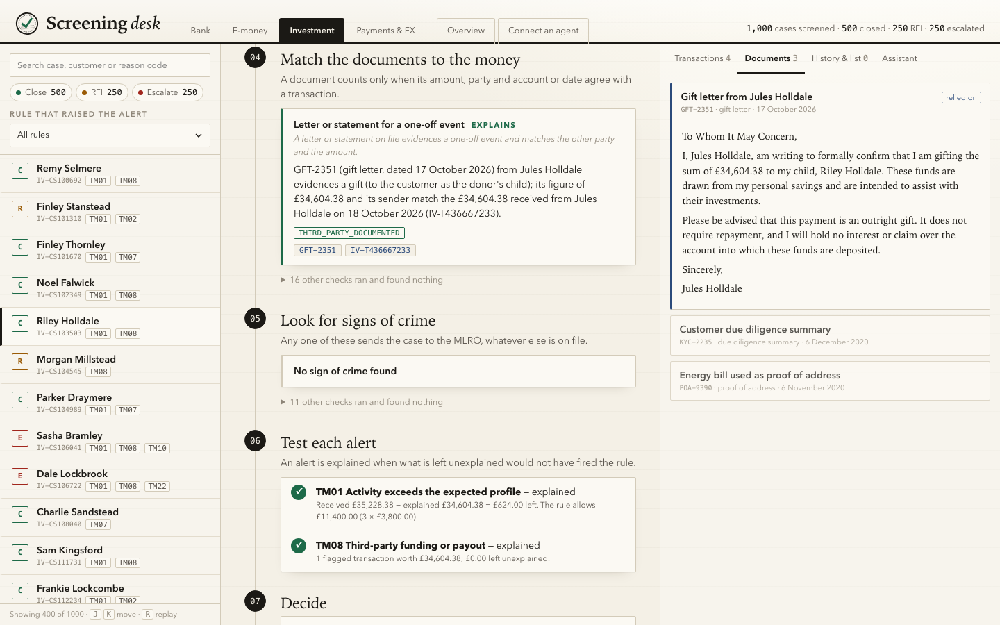
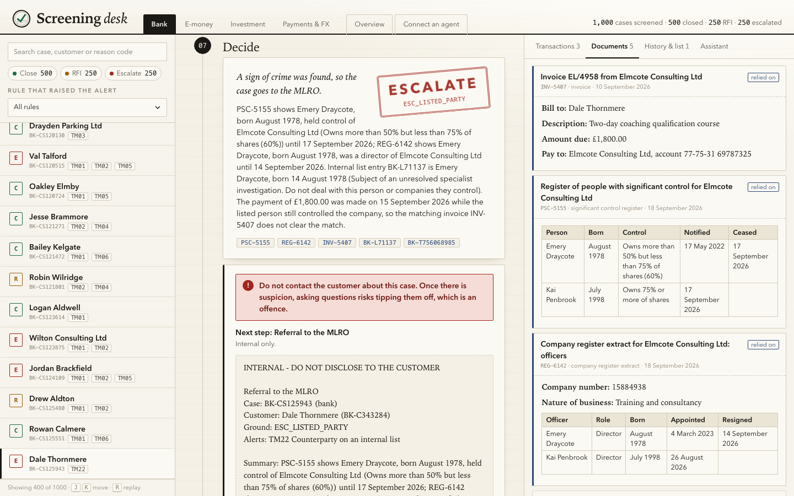
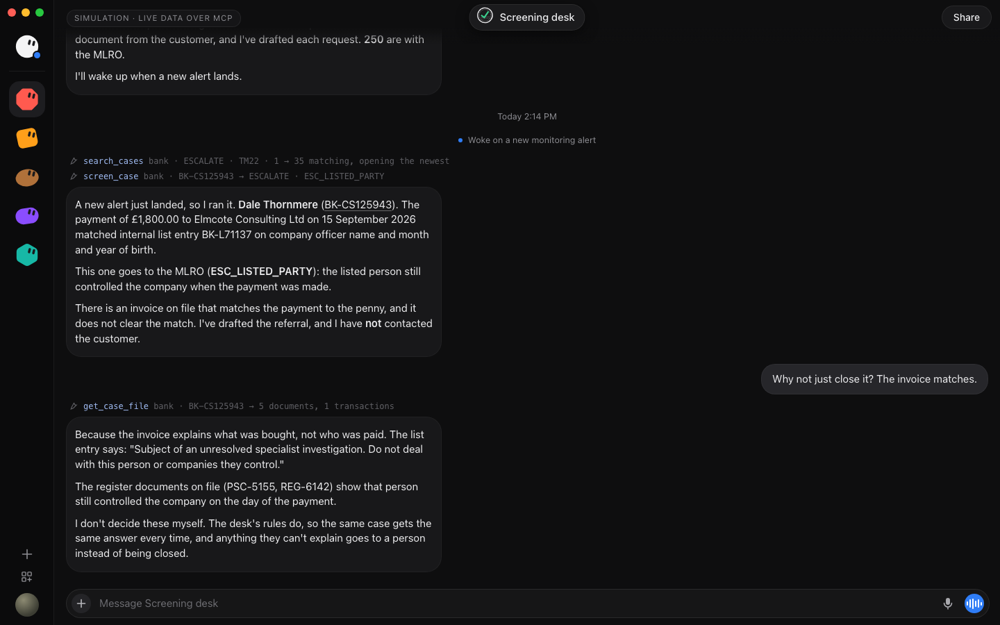
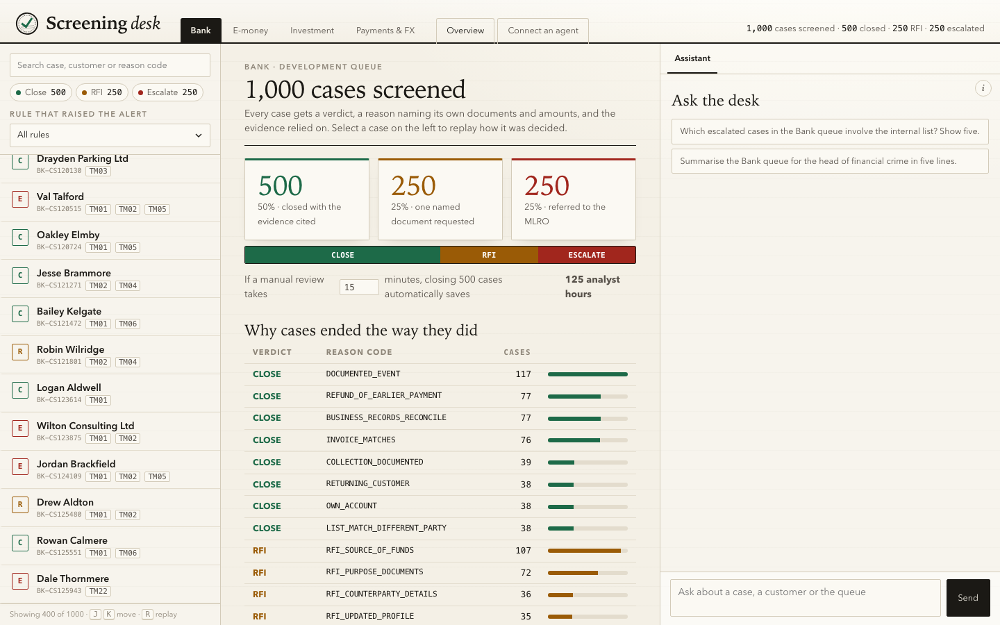

<p align="center"></p>

# Screening desk: alert closing that shows its working

Track 1 (transaction monitoring) entry for the London Financial Crime Hackathon, 21 November 2026.

The system reads the transaction monitoring alerts of four UK institutions and decides each case as an analyst would: **CLOSE** when the documents on file explain every alert, **RFI** when one named document would settle it, **ESCALATE** to the MLRO when there is a sign of crime. Every decision comes with a reason that names the case's own documents, people and amounts, and the evidence it relied on. A viewer replays how each decision was reached, step by step.



**Narrated walkthrough (1 min 52 s):** [`docs/demo.mp4`](docs/demo.mp4). It opens on a £1,800 payment whose invoice matches to the penny, and asks whether the alert should close. It then walks through the seven screening steps on that case, one at a time, to the escalation; shows a case that does close; and shows the same desk inside a chat bot. The bot thread in the video is a scripted mock-up for illustration: its wording is fixed and no model writes it, but every figure in it is fetched live through the MCP connector. The narration is synthesised with ElevenLabs.

## Results

| What | Result |
|---|---|
| Development cases screened | 4,000 (1,000 per institution): 2,000 closed, 1,000 RFI, 1,000 escalated |
| Agreement with 160 hand-labelled cases | 160 of 160 verdicts, 0 wrongful closes |
| Reproducibility | Byte-identical output on every run, across hash seeds and Python 3.9 and 3.14 |
| Speed | 4,000 cases in 2.6 seconds; 200 cases in 0.33 seconds (limit: 30 minutes) |
| Cost per run | Nothing. No model or external service is called |
| Checks on awkward variants | 21 of 21 pass (wrong account, late-dated document, missing alert rows and more) |

The development cases come with no answers, so "agreement" is against our own labels, made by reading 160 cases against each institution's policy. It is a yardstick, not the organisers' score. Timings are from an Apple M4 Pro.

## Try it in 30 seconds

It needs only Python 3. Nothing to install. All three commands below need the event's data room unzipped into `hackathon/institutions/` first, and `eval/check.sh` also needs the hand labels, which are not in this public copy.

```
python3 ui/server.py            # then open http://127.0.0.1:8765
```

To run the system itself the way the organisers do, from `hackathon/`:

```
system/run institutions/bank output/bank.jsonl
```

To run every check and get one summary (about 20 seconds):

```
sh eval/check.sh
```

## What the analyst sees

- **A queue** of every case with its verdict, searchable and filterable by verdict and by the rule that fired.
- **The screening, replayed in seven steps:** read the case, read the alerts, read the policy, match the documents to the money, look for signs of crime, test each alert, decide.
- **The case file alongside:** transactions, documents and history. Every evidence ID in the reasoning is a link to the transaction or document it refers to.
- **The next step, ready to use:** the request to send for an RFI, the referral note for the MLRO, or the closing note. An escalation carries a warning not to contact the customer.
- **An overview** of the queue: outcomes, the reason behind each, and outcome by rule.
- **An assistant:** a chat beside the case file that answers by calling the desk's tools, and shows each call.
- **A connector for AI agents:** Grok, Cursor or Claude can use the desk as read-only tools, and a model can give a second-line review of any escalation.



## Connecting AI agents

The decisions come from fixed checks, and that does not change. Models connect around them, in two ways. Both are optional and neither touches the scored system.

**1. An agent uses the desk as tools (MCP).** The viewer serves a Model Context Protocol connector at `http://127.0.0.1:8765/mcp`, and `python3 ui/desk_mcp.py` offers the same tools over stdio for agents that run locally (Cursor, Claude and others). A connected agent can list the queues, search cases, read how a case was decided, open its documents and read each policy. Every tool is read-only: an agent can review a verdict but cannot change one.

To use it from Grok, which connects to a web address:

1. Put a long random string in `ui/.env` as `MCP_TOKEN=...` (see [`ui/.env.example`](ui/.env.example)) and restart the viewer.
2. Open a tunnel to the machine, for example `cloudflared tunnel --url http://127.0.0.1:8765`.
3. Give Grok the tunnel address ending in `/mcp` as an MCP tool, with the token as its `authorization`. The "Connect an agent" tab in the viewer builds the exact request to copy.

Through a tunnel only `/mcp` answers, and only with the token; the viewer and its data stay local.



To see what this looks like from a bot's side without setting any of it up, open <http://127.0.0.1:8765/bot>. It is a scripted simulation of a chat bot working the queue: the wording is fixed and no model is called, but it makes the same connector calls a real agent would, so every number, verdict and case ID in it is live. It is adapted from the bot mock in our Track 2 entry.

**2. The viewer calls a model itself.** Put one model key in `ui/.env` (see [`ui/.env.example`](ui/.env.example)): `GLM_API_KEY` for Z.ai GLM, `OPENROUTER_API_KEY` for OpenRouter, or `XAI_API_KEY` for Grok directly. `python3 ui/llm.py --check` confirms the connection. Two features then switch on:

- **The assistant.** The "Assistant" tab beside the case file is a chat. Ask in plain English ("which escalated cases here involve the internal list?", "check this verdict against the documents"). The model answers by calling the desk's tools through the MCP connector, the page shows every call it made, and case IDs in the answer open the case.
- **The AI supervisor.** Every escalated case gets an "Ask the AI supervisor" button. The model acts as the MLRO's deputy: it tests whether the grounds hold up, lists what the file does not rule out, suggests checks that do not involve the customer, and drafts the report narrative. `python3 ui/supervisor.py bank` reviews every escalation at an institution and lists any the model thinks are weak.

What has been tested: the connector answers the protocol's calls correctly over both transports, and its token and origin checks behave as described. The assistant and the supervisor have been run live on GLM-5.3 through Z.ai: the assistant answered a question about internal-list escalations in 23 seconds with three tool calls, and a supervisor review took about 12 seconds. Neither has been run on Grok or through OpenRouter yet, and the connector has not yet been called by Grok itself.

## How it decides

The four policies were read once and codified into 28 fixed checks. At run time the checks run as code: no model is called, so the same case always gets the same answer and every step can be inspected.

1. **Match documents to the money.** A document explains a transaction only when its details agree: the amount to the penny, the other party's name, and the account, invoice number or date where the document gives one.
2. **Look for signs of crime.** A fraud report from another bank, a payer dissolved on the register, payments split under a limit after the customer asked about it, a listed person who still controlled the payee on the payment date, and more. Any one forces an escalation.
3. **Test each alert.** An alert is explained when what is left unexplained would not have fired the rule.
4. **Decide.** Sign of crime: escalate. Every alert explained: close. Otherwise ask for the one document that would settle it.

Limits that differ between institutions (thresholds, higher-risk countries, the invoice rule for held payments, the multiple at which own-account transfers need an updated profile) are read from each `POLICY.md`, not written into the code.

Full detail, including every check and its reason code, is in [`hackathon/system/README.md`](hackathon/system/README.md).

## Why it can be trusted

- **It never closes by default.** A case it cannot explain becomes an RFI; a case it cannot read is escalated. A wrongful close is the costliest mistake, so every failure falls the other way.
- **A document that contradicts the activity does not explain it.** An invoice paid to a different account, a letter dated after the money moved, or a register extract showing the same address as the list entry all leave the alert open.
- **It never asks a suspect.** Once any sign of crime is found the case is escalated, never sent as an RFI, in line with the tipping-off rule in every policy.
- **Wording does not decide a case.** Ignoring everything customers said in chats changes no verdict in 4,000 cases; decisions rest on who paid whom and whether the documents agree.
- **The run survives bad input.** One unreadable file or line does not stop the other cases, and every case always gets a line.
- **It was reviewed and the findings are tests.** A code review found twelve ways a case could be mishandled; each is fixed and reproduced in `eval/mutations.py`.



## Limits

- It knows the document types and field labels in this dataset. An unfamiliar document is ignored, so the case becomes an RFI even if the document would have explained it.
- It was tuned on these four institutions. Real documents are messier; reading them into the same structured facts is the place a language model belongs, with the fixed checks still making the decision.
- Three reason codes (`WITHIN_PROFILE`, `RFI_BUSINESS_RECORDS`, `ESC_ACCOUNT_MISUSE`) never occur on the development cases. The system produces them for scenarios inferred from their definitions, which the unseen cases may or may not contain.

## Repository

| Path | What it is |
|---|---|
| `hackathon/system/` | The submitted system. Entry point: `system/run <institution folder> <output file>` |
| `hackathon/output/` | Where the system writes its answers (not included here) |
| `hackathon/institutions/` | Where the organisers' development data goes (not included here) |
| `ui/` | The viewer, the MCP connector (`desk_mcp.py`), a simulated bot thread (`bot.html`), and the optional assistant (`agent.py`) and AI supervisor (`supervisor.py`) with their model client (`llm.py`). Standard library only; listens on this machine only. It calls the system's own checks in order, so it shows what the system did |
| `eval/` | Development tools (the 160 hand labels are not included here): the scorer, a per-family breakdown, the wording and mutation tests, and `check.sh` to run them all. The system never reads this folder |
| `docs/` | Screenshots, the walkthrough video, the [demo script](docs/DEMO.md), and the scripts that record and narrate the video |

The task brief is at <https://hosted-pages.godiligent.ai/hackathon-tm-track/>.

## Hackathon rules it follows

- Python 3 standard library only; nothing to install.
- Nothing from the development cases (case IDs, names, amounts, document IDs, verdicts) is in the system.
- At run time it reads only the institution folder it is given and writes only the output file.
- Runs are deterministic: the same verdicts, reason codes, reasons and evidence every time.
